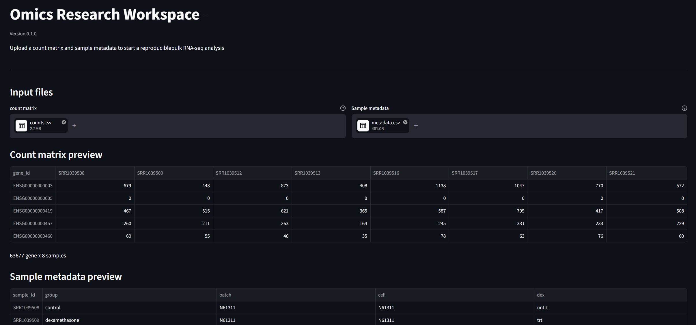

# Omics Research Workspace

A reproducible Streamlit app for validating bulk RNA-seq inputs, running two-group differential expression analysis with DESeq2, and downloading traceable results.


## From input validation to DESeq2 results

The app validates count matrices and sample metadata before running DESeq2 and returning downloadable differential-expression results.



## Installation
Clone the repository and create the analysis environment:

```bash
git clone https://github.com/EasonWangBIO/omics-research-workspace.git
cd omics-research-workspace
conda env create -f environment.yml
```
### Requirements

- Git
- Conda or Miniforge
- Linux, macOS, or Windows with WSL2

Activate the environment and start the app:

```bash
conda activate omics-workspace
python -m streamlit run app.py
```
Open <http://localhost:8501> in a web browser.

## Current workflow
1. Upload a raw count matrix and sample metadata in CSV or TSV format.
2. Validate count values, experimental groups, biological replicates, and
   sample ID agreement.
3. Select a reference group and comparison group.
4. Run DESeq2 through an isolated Python-to-R interface.
5. Review the comparison, result counts, top result rows, and analysis log.
6. Download the complete differential-expression result as CSV.

Each run stores its inputs and generated result under the ignored `runs/`
directory. Streamlit session state keeps the current result visible during
normal in-app reruns.

## Reproducible example data

`examples/example2/` is rebuilt from Bioconductor's official `airway` data
package. Its source, LGPL license, study citation, transformations, and rebuild
command are documented in `examples/example2/README.md`.

The small files under `examples/example1/` remain useful for fast input and
validation checks but are too small for a representative DESeq2 model fit.

## Planned increments

- PCA and sample-level quality control
- Volcano, MA, correlation, and expression heat maps
- Configurable thresholds and gene annotation
- GO and KEGG enrichment analysis
- Reproducible reports and run history

## From input validation to DESeq2 results

